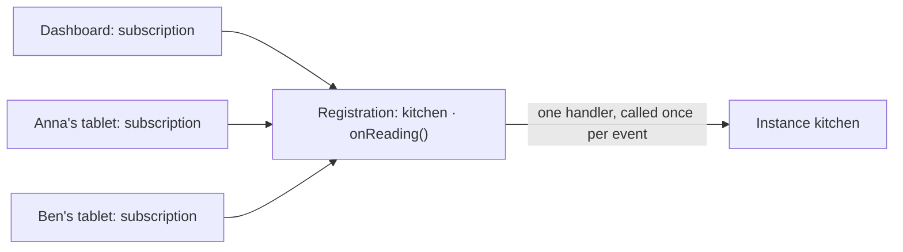

# Events

Many clients can listen to the same events of the same instance - a
dashboard, two operators' tablets, a service that logs - and an agent keeps
that cheap and orderly: it calls the class once, hands every event to every
listener, greets newcomers with the current state, and cleans up when the
last listener leaves. This page explains how.

## Event functions

An **event function** calls a handler again and again until it is released:

```javascript
await sensor.onReading(value => console.log(value))      // an event function of the class
await machine.on('alarm', alarm => console.log(alarm))   // Node's EventEmitter
await opcua.monitorNode('ns=1;s=temp', value => {})      // any name, declared as one
```

The client recognizes an event function by its declaration or its name:

- its documentation declares `@returns {Registration}` (the client needs the
  class's meta data for that: `requiresSchema: true`);
- its name is `on` followed by a capital letter: `onReading`, `onChange`;
- it is `on(event, handler)` or `addListener(event, handler)`.

Any other function argument is a one-shot [callback](calls.md#callbacks).
To treat a function with another name as an event function without
declaring it, call it through `proxy.vrpcOn('monitorNode', ...args)`.

## Registrations and subscriptions

Two words make the rest of this page precise:

- A **registration** is the one call of an event function on one instance
  (or class) with one set of arguments, the handlers left out. The agent
  owns it.
- A **subscription** is one listener's wish to receive the events of a
  registration. Each client owns its subscriptions.



The agent keeps these promises, whatever clients repeat, flap or restart:

1. **One registration per function and arguments.** The first subscription
   calls the event function; every further one joins it. Ten browsers on
   `onReading()` are one handler on the class, not ten. Arguments are
   compared by value: `onTopic('line/+/state')` from two clients is one
   registration, `onTopic('#')` another.
2. **Every event reaches every subscription once.**
3. **Every new subscription is greeted** - when the class says how
   (below).
4. **The last subscription out releases the registration**, and its handler
   is silent afterwards, whatever the class still does with it.
5. **Every end is told** to the subscribers.

A subscription is a set member: subscribing the same callback to the same
function with the same arguments again changes nothing, and withdrawing it
once ends it. One callback on two functions, or on two sets of arguments, is
two subscriptions.

## Greeting

A newcomer usually wants the current state at once, without polling and
without waiting for the next change. Since the event function runs once per
registration, the class tells the agent how to greet: its registration has a
`greet` function, and the agent calls it for every new subscription, the
first one included, with a handler that reaches that subscriber alone.

```javascript
onReading (handler) {
  this._emitter.on('reading', handler)
  return {
    [Symbol.dispose]: () => this._emitter.off('reading', handler),
    greet: greeting => greeting(this._reading)
  }
}
```

Without `greet`, nobody is greeted: the agent keeps no earlier event and
replays none. Only the class knows what a newcomer needs - a value, or the
full table a stream of row changes refers to.

## Releasing

When the last subscription leaves, the agent releases the registration
through the object the event function returned - its
`[Symbol.dispose]()` or `[Symbol.asyncDispose]()` - so the class stops what
it set up: it unsubscribes a broker topic, stops monitoring a node, removes
a listener. For Node's own `EventEmitter.prototype.on` the agent knows the
undo itself (`removeListener`). A class that returns nothing it can be
released through keeps its registration, silent, and reuses it for the next
subscriber.

How to write an event function, with every option of its registration, is
the subject of the guide [Writing event functions](../guides/event-functions.md).

## Withdrawing

A subscription leaves when it is withdrawn:

```javascript
await client.unsubscribe(handler)            // every subscription of this callback
await client.unsubscribe(id)                 // one subscription, by its id
await machine.off('alarm', handler)          // Node's way, the same effect
await machine.removeAllListeners('alarm')    // this client's subscriptions of 'alarm'
```

Withdrawing only ever affects your own subscriptions: `removeAllListeners`
never removes another client's listener, nor one the class keeps for itself.
A subscription also leaves when its client's connection goes - closed or
broken - since the agent watches the presence of every connection that
subscribed.

## Ends and losses

A subscription can stop for two different kinds of reasons, and VRPC keeps
them apart:

- An **end** is decided. The source ended the registration (an MQTT topic
  was unsubscribed by the broker, a monitored node deleted by the server), or
  somebody ended it on purpose (`client.endRegistration()`). The agent tells
  every subscriber, and the client emits `ended` (id, reason, by, info);
  the subscription is gone until somebody subscribes again.
- A **loss** is not decided. The agent went offline, or the instance went
  away. The client emits `lost` (id, reason, info) - and a loss heals:
  when the agent of a lost subscription comes back, the client subscribes
  again by itself and emits `healed`. An agent that only lost its
  connection still holds the subscription and changes nothing; one that
  restarted registers it anew. The loss of an instance is yours to heal:
  create it again, then subscribe again.

```javascript
client.on('ended', (id, reason, by) => console.log(`${id} ended (${reason}, by ${by})`))
client.on('lost', (id, reason) => console.log(`${id} lost: ${reason}`))
client.on('healed', id => console.log(`${id} is back`))
```

Withdrawals you make while an agent, or your own client, is offline are sent
once both are back.

## Seeing who listens

An agent lists the registrations of an instance or a class - function,
arguments, state, events per second, and who subscribes - and anybody
allowed to can end one for all its subscribers:

A label names a subscriber in such a listing. It travels with the
subscription, so give a callback its label before you subscribe it:

```javascript
client.setSubscriberLabel(handler, { app: 'dashboard', user: 'anna' })
await sensor.onReading(handler)
const registrations = await client.getRegistrations({ instance: 'kitchen', agent: 'house' })
// [{ function: 'onReading', args: [], state: 'live', subscriptions: [{ label: { app: 'dashboard', user: 'anna' }, callAll: false }], events: 1840, rate: 0.5 }]
await client.endRegistration({
  agent: 'house', className: 'Sensor', instance: 'kitchen',
  functionName: 'onReading', args: [], by: 'anna'
})
```

Subscription ids never appear in a listing: they are secrets of their
connection.

## Events of every instance

`callAll` subscribes one callback to an event function of every shared
instance of a class. Each event then names its instance first:

```javascript
await client.callAll({
  agent: 'line-1',
  className: 'Press',
  functionName: 'onCycle',
  args: [(instance, count) => console.log(instance, count)]
})
```

With `instances: 'press-a*'` it subscribes the instances that selection
names alone (see [Calls](calls.md)); one callback on two selections is two
subscriptions. `client.unsubscribe(callback, { instance: 'press-b' })` stops
it at one instance while the others keep delivering.

## The protocol underneath

Each subscription has an id the client derives from what it subscribes to;
the agent publishes every event to a topic that id names. Section
[12 of the protocol specification](../spec/protocol.md#12-events) has every
rule.
