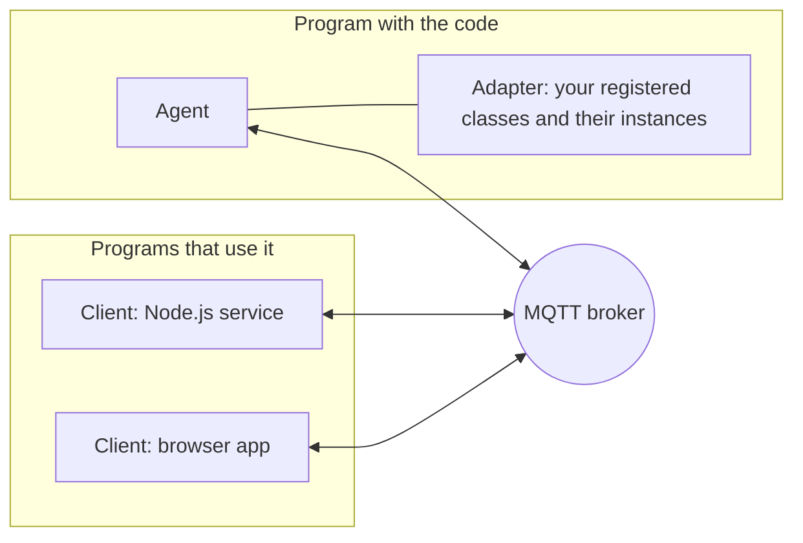

# How VRPC works

VRPC makes the classes, instances and functions of one program callable from
other programs, as if they were local. You register a class in the program
that has it; any other program creates instances of it, calls their
functions and receives their events, without an API layer in between: no
routes, no schemas to keep in step, no WebSocket plumbing.

This page explains the moving parts. To try VRPC, start with the
[README](../../README.md); for the exact rules on the wire, see the
[protocol specification](../spec/protocol.md).

## Three parties



- **The agent** runs inside the program that offers code. Its **adapter**
  holds the classes you registered and the instances created from them; the
  agent connects that adapter to the broker, receives requests and sends the
  answers. In JavaScript these are `VrpcAdapter` and `VrpcAgent`.
- **The client** runs in every program that uses the code - a backend
  service, a browser, a command-line tool. It discovers agents, creates and
  deletes instances, and hands you **proxies**: objects whose functions call
  the real ones remotely. In JavaScript this is `VrpcClient`.
- **The MQTT broker** routes every message. Agents and clients only ever
  connect *out* to the broker, never to each other: an agent behind a
  firewall or a NAT, on a machine without a public address, is reachable as
  long as it can reach the broker.

A **domain** groups agents and clients: they see and reach each other within
one domain only. An agent has a **name**, unique in its domain.

## What happens on a call

```javascript
const sensor = await client.getInstance('kitchen', { agent: 'house' })
const value = await sensor.read()
```

1. The client publishes one message to a topic that names the target:
   `<domain>/house/Sensor/kitchen/read`.
2. The broker delivers it to the agent `house`, which subscribed every topic
   of its classes and instances.
3. The agent calls `read()` on the instance `kitchen` and publishes the
   result to a topic of the calling connection.
4. The client resolves `value` with it - or rejects with the error the
   function threw, or with a timeout when no answer came.

Every function call is asynchronous for the caller, whatever the function
is. A function that returns a promise is answered once the promise settles.
See [Calls, callbacks and errors](calls.md).

## Finding things

Agents announce themselves. When an agent serves, it publishes - retained,
so every client that connects later gets them too - its **agent info**
(online or offline, its host, its protocol version) and a **class info** per
class (its static and member functions and its shared instances). Clients
subscribe to these and always know which agents are online, what they offer
and which instances exist:

```javascript
client.getAvailableAgents()
client.getAvailableClasses({ agent: 'house' })
client.getAvailableInstances({ className: 'Sensor', agent: 'house' })
client.on('instanceNew', (instances, { agent, className }) => { /* ... */ })
```

When an agent's connection breaks, the broker publishes its **last will**:
the agent info, now offline. Clients learn it at once.

## Instances and their lifetime

Clients create instances on an agent and delete them; an instance is either
**shared** (visible to every client) or **isolated** (it belongs to the
connection that created it and goes when that connection goes). An object
that runs something - a clock, a socket, a device - releases it when it is
deleted. See [Instances](instances.md).

## Events

A function that calls a handler again and again - `onReading(handler)`,
`on('update', handler)` - is an **event function**. Many clients can listen
to the same events of the same instance; the agent calls the event function
once and hands every event to every subscriber, greets newcomers with the
current state, releases the registration when the last subscriber leaves,
and tells subscribers when it ends. See [Events](events.md).

## Why MQTT

- **Outbound connections only.** Edge devices, factory machines and browsers
  all connect out; nothing needs an open port, a reverse proxy or a VPN.
- **Built for unstable networks.** Connections break and come back; agents
  and clients reconnect by themselves, and the broker tells everyone when a
  peer went away.
- **Access control at the broker.** Every request is a topic that names
  agent, class, instance and function, so a broker's topic permissions
  decide who may call what (see the specification's
  [security considerations](../spec/protocol.md#14-security-considerations)).
- **One broker for everything.** Requests, answers, events and presence all
  travel through it; there is no second channel to secure and operate.

## What VRPC is not

- **Not a message queue.** A request whose answer does not come in time
  fails; nothing is stored and delivered later. Events that happen while a
  subscriber is away are not replayed.
- **Not a database or a state store.** Instances live in the agent's memory.
  To keep them across agent restarts, use
  [persistence](../guides/persistence.md).
- **Not a schema-first RPC.** There is no interface definition to compile.
  An agent describes what it offers at run time (its class info, optionally
  with documentation from your JSDoc), and clients adapt to it.

## Implementations

VRPC exists for JavaScript (this repository: Node.js and the browser, with
[React](https://github.com/heisenware/vrpc-react) hooks on top),
[C++](https://github.com/heisenware/vrpc-hpp),
[Python](https://github.com/heisenware/vrpc-py) and
[Arduino](https://github.com/heisenware/vrpc-arduino). They all speak the same
[protocol](../spec/protocol.md), so a browser can call a C++ agent and a
Python service can listen to the events of a Node.js agent. To implement VRPC
in another language, see [Implementing VRPC](../spec/porting.md).
