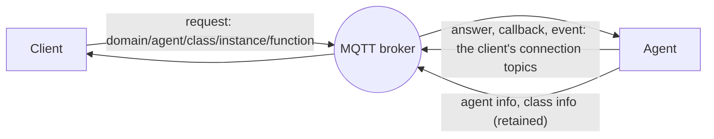
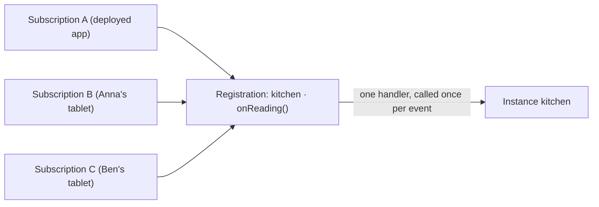
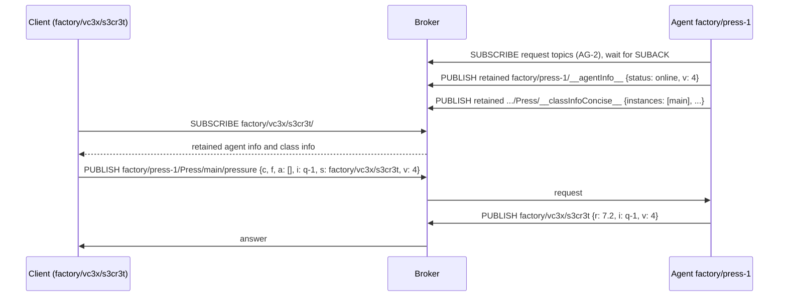
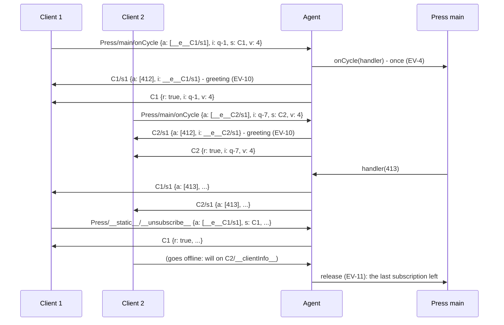
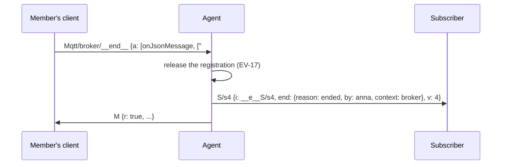

# The VRPC protocol, version 4

This document specifies how VRPC agents and clients talk to each other over
MQTT: the topics they use, the messages they exchange and what each message
obliges the other side to do. It binds every implementation, whatever its
language. An agent or a client that follows it interoperates with every other
one that does.

- **Version:** 4. The reference implementation is
  [vrpc-js](https://github.com/heisenware/vrpc-js) from 3.15.0, agent and
  client. Section 13 says how version 4 meets peers of version 3.
- **Audience:** authors of VRPC agents and clients in any language, and
  anyone who needs to know exactly what travels on the wire. To *use* VRPC
  from JavaScript you do not need this document; start with the
  [documentation overview](../README.md).

## Contents

1. [Overview](#1-overview)
2. [Conventions](#2-conventions)
3. [Terms](#3-terms)
4. [Transport](#4-transport)
5. [Names and topics](#5-names-and-topics)
6. [Messages](#6-messages)
7. [Agents: serving and announcing](#7-agents-serving-and-announcing)
8. [Clients: connection and presence](#8-clients-connection-and-presence)
9. [Calls](#9-calls)
10. [Instances](#10-instances)
11. [Calling all instances](#11-calling-all-instances)
12. [Events](#12-events)
13. [Versions and compatibility](#13-versions-and-compatibility)
14. [Security considerations](#14-security-considerations)
15. [Known limitations](#15-known-limitations)
16. [Optional features](#16-optional-features)

Appendices:

- [Appendix A: Example exchanges](#appendix-a-example-exchanges)
- [Appendix B: Changes from version 3](#appendix-b-changes-from-version-3)

## 1. Overview

VRPC makes the classes, instances and functions of a program callable from
other programs. Three parties take part:

- An **agent** runs next to the code it offers. It registers classes, keeps
  their instances, and executes the calls that reach it.
- A **client** calls that code: it creates and deletes instances, calls
  their functions, and receives their events.
- An **MQTT broker** routes every message between them. Agents and clients
  connect to it; they never connect to each other.

Every request is one MQTT message to a topic that names the target: domain,
agent, class, instance and function. The agent answers on a topic of the
calling connection. Events travel the same way, from the agent to a topic the
subscriber chose.



## 2. Conventions

The key words MUST, MUST NOT, REQUIRED, SHALL, SHALL NOT, SHOULD, SHOULD NOT,
RECOMMENDED, MAY and OPTIONAL are to be interpreted as described in
[RFC 2119](https://www.rfc-editor.org/rfc/rfc2119) and
[RFC 8174](https://www.rfc-editor.org/rfc/rfc8174) when, and only when, they
appear in all capitals.

Every normative rule carries an identifier such as **TR-1**. Identifiers are
never reused; tests cite them. Text outside the numbered rules explains and
gives examples, but does not add obligations.

Paragraphs headed *In vrpc-js* describe how the reference implementation
fills in a choice the protocol leaves open. They are not requirements.

In topics, `<name>` stands for a value. JSON examples use `...` for values
that do not matter in the example.

## 3. Terms

| Term | Meaning |
| --- | --- |
| **Domain** | A name that groups agents and clients. They see and reach only each other within one domain. |
| **Agent** | A peer that offers classes and executes calls on them (section 7). |
| **Client** | A peer that sends requests to agents (section 8). |
| **Class** | A named set of static functions and of member functions its instances offer. |
| **Instance** | A named object of a class, kept by an agent. *Shared* instances are visible to every client; *isolated* ones belong to the connection that created them (section 10). |
| **Context** | What a request addresses: an instance, or a class for static functions. |
| **Connection id** | The name of one client connection: `<domain>/<mqttClientId>/<secret>` (section 8). Answers, callbacks and events for that connection travel on topics under it. |
| **Request** | A message from a client asking an agent to call a function (section 6.1). |
| **Answer** | The agent's reply to a request (section 6.2). |
| **Event function** | A function that calls a handler again and again until it is released, such as `onChange(handler)` (section 12). |
| **Registration** | The one call of an event function on one context with one set of arguments, owned by the agent and shared by every subscription that asks for the same (section 12). |
| **Subscription** | A client's wish to receive the events of a registration, named by a subscription id (section 12). |

## 4. Transport

- **TR-1.** Agents and clients MUST be MQTT clients of the same broker (or
  broker cluster) and MUST speak MQTT 3.1.1. A peer MAY connect with MQTT 5
  but MUST NOT rely on features MQTT 3.1.1 lacks.
- **TR-2.** Peers MUST connect with a clean session and MUST subscribe their
  topics afresh after every connect. The protocol keeps no state in the
  broker except retained messages (TR-4).
- **TR-3.** Peers MAY publish and subscribe at QoS 0 or 1. The protocol never
  relies on delivery: a request whose answer does not arrive is the caller's
  to time out.
- **TR-4.** Only agent info and class info (section 7) are published
  retained. A peer MUST NOT publish any other message retained. A zero-length
  retained message clears a retained topic (TR-5 does not apply to it).
- **TR-5.** Every payload MUST be a UTF-8 encoded JSON object. A peer MUST
  ignore a message whose payload is not one.
- **TR-6.** Peers MUST NOT rely on the broker keeping the order of messages
  published to different topics. A peer that needs one message to take
  effect before another waits for the first one's answer.
- **TR-7.** When the broker refuses a subscription, a peer SHOULD report it
  and SHOULD try again with a growing delay until the broker grants it. A
  broker that asks an authorization service may refuse everything while that
  service is away.

*In vrpc-js:* agents and clients publish and subscribe at QoS 0 unless
`bestEffort` is false (`--no-bestEffort` on the command line). A client
times out a request after 12 seconds.
Refused subscriptions are retried after 1 s, doubling up to 30 s, and
reported as an `error` event.

## 5. Names and topics

### 5.1 Names

- **TOP-1.** A domain name and an agent name MUST be non-empty and MUST NOT
  contain `/`, `+`, `#` or `*`.
- **TOP-2.** Within a domain an agent name SHOULD name exactly one running
  agent. An agent's MQTT client id SHOULD be derived from its domain and
  name, so that a second agent of the same name takes over the first one's
  session instead of mixing their messages.
- **TOP-3.** A class name and a function name MUST be non-empty and MUST NOT
  contain `/`, `+` or `#`. They MUST NOT have the form `__<word>__` unless
  this document defines that name.
- **TOP-4.** An instance name MUST be a non-empty string without `/`, `+`,
  `#` or `*`, and MUST NOT be `__static__`. An agent MUST refuse to create an
  instance under any other name (INST-2). (`*` would read as a pattern,
  ALL-5.)

*In vrpc-js:* an agent created without a name is named
`<user>-<installationId>@<hostname>-<platform>-js`, the installation id a
short hash of where vrpc is installed, so the name stays the same however
the agent is started. A browser agent without a name takes eight random
characters on every start. Name agents explicitly in production.

### 5.2 Reserved names

| Name | Where | Meaning |
| --- | --- | --- |
| `__static__` | instance level of a request topic | the request addresses the class, not an instance |
| `__global__` | class level of a request topic | the request addresses a global function (section 16.1) |
| `__agentInfo__` | third level | agent info (section 7.2) |
| `__classInfo__`, `__classInfoConcise__` | fourth level | class info (section 7.3) |
| `__clientInfo__` | fourth level, under a connection id | presence (section 8.2) |
| `__createShared__`, `__createIsolated__`, `__delete__` | function level | instance lifecycle (section 10) |
| `__callAll__`, `__callMatching__` | function level | calling every instance of a class, or those a selection names (section 11) |
| `__unsubscribe__`, `__registrations__`, `__end__` | function level | withdrawing, listing and ending registrations (section 12) |
| `__f__…` | argument value | a one-shot callback (section 9.3) |
| `__e__…` | argument value | a subscription id (section 12.2) |
| `__p__…` | answer value | a promise (section 9.4) |

### 5.3 Topics

| Topic | Levels | Published by | Retained | Carries |
| --- | --- | --- | --- | --- |
| `<domain>/<agent>/__agentInfo__` | 3 | agent; the broker for its will | yes | agent info |
| `<domain>/<agent>/<class>/__classInfo__` | 4 | agent | yes | class info with meta data |
| `<domain>/<agent>/<class>/__classInfoConcise__` | 4 | agent | yes | class info without meta data |
| `<domain>/<agent>/<class>/__static__/<function>` | 5 | client | no | a request to a class |
| `<domain>/<agent>/<class>/<instance>/<function>` | 5 | client | no | a request to an instance |
| `<connectionId>` | 3 | agent | no | answers, promise answers, one-shot callbacks |
| `<connectionId>/<topicId>` | 4 or more | agent | no | events and ended notices of a subscription |
| `<connectionId>/__clientInfo__` | 4 | client; the broker for its will | no | presence |

A topic's last level tells messages of the same depth apart: a class info
topic ends in `__classInfo__` or `__classInfoConcise__`, a presence topic in
`__clientInfo__`.

## 6. Messages

### 6.1 Request

A client publishes a request to the topic of its context and function
(section 5.3).

| Field | Type | Required | Meaning |
| --- | --- | --- | --- |
| `c` | string | SHOULD | the context: an instance name, or a class name for a class |
| `f` | string | SHOULD | the function |
| `a` | array | yes | the arguments, in order (section 9.2) |
| `i` | any JSON value | yes | the correlation id; the answer carries it back |
| `s` | string | yes | the sender: the client's connection id (section 8.1) |
| `v` | number | yes | the sender's protocol version, `4` |
| `l` | object | no | subscriber labels, `{ "<subscriptionId>": <label> }` (section 12.11) |

- **MSG-1.** An agent MUST take the context and the function from the
  request topic and MUST ignore `c` and `f`: a broker can authorize topics,
  not payloads. The context is the class level of the topic when the
  instance level is `__static__`, and the instance level otherwise. A client
  SHOULD still send `c` and `f`; embedded use without MQTT reads them.
- **MSG-2.** An agent MUST ignore a request whose `s` is not a connection id
  of its own domain (SEC-2): it has no safe place to answer.
- **MSG-3.** A missing `a` counts as no arguments. An agent MUST answer a
  request whose `a` is not an array with an error.
- **MSG-4.** A client SHOULD give every pending request its own `i`. An
  agent MUST answer with `i` unchanged.
- **MSG-5.** Peers MUST ignore fields this document does not define.

*In vrpc-js:* `i` is `<8 random characters>-<counter>`.

### 6.2 Answer

An agent publishes the answer to a request to the request's `s`.

| Field | Type | Meaning |
| --- | --- | --- |
| `r` | any JSON value | the result; absent when the function returned nothing |
| `e` | error | the error, instead of `r` |
| `i` | as in the request | the request's correlation id |
| `v` | number | the agent's protocol version, `4` |

- **MSG-6.** An answer MUST carry exactly one of `r` and `e`, except that a
  function that returned nothing is answered without either. It MUST carry
  the agent's own protocol version in `v`, and MUST NOT carry anything of the
  request but `i`.
- **MSG-7.** An error MUST be an object `{ "message": <string>, "cause":
  <any JSON value> }`; `cause` is optional. A client MUST also accept a plain
  string as an error: agents before version 4 and agents in other languages
  send one.
- **MSG-8.** A result JSON cannot encode MUST be answered with an error. An
  agent MAY replace circular parts of a result instead.

```json
{ "r": "pong", "i": "Xa3kP9qz-17", "v": 4 }
{ "e": { "message": "Could not find function: pnig" }, "i": "Xa3kP9qz-18", "v": 4 }
```

*In vrpc-js:* circular parts of a result become strings such as
`"[Circular ~.r]"`; a `BigInt` result is answered with an error.

### 6.3 Messages the agent sends on its own

| Message | Topic | Fields |
| --- | --- | --- |
| second answer of a promise (section 9.4) | `<connectionId>` | `r` or `e`, `i` (the promise id), `v` |
| one-shot callback (section 9.3) | `<connectionId>` | `a` (the callback's arguments), `i` (the callback id), `v` |
| event (section 12.4) | the topic its subscription id names | `a` (the event's arguments), `i` (the subscription id), `v` |
| ended notice (section 12.8) | the topic its subscription id names | `i` (the subscription id), `end`, `v` |
| undeliverable notice (CALL-10, EV-22) | where the callback or the event would have gone | `i` (the callback or subscription id), `e`, `v` |

## 7. Agents: serving and announcing

### 7.1 Serving

- **AG-1.** After every connect, an agent MUST subscribe its request topics
  and MUST wait until the broker has answered every one of those
  subscriptions before it publishes its agent info and class info. A client
  acts on the announcement at once; a request published before its topic is
  subscribed is lost.
- **AG-2.** An agent's request topics are:
  - for every class, `<domain>/<agent>/<class>/__static__/<function>` for
    every static function its class info lists, the reserved
    `__createShared__`, `__createIsolated__`, `__delete__` and `__callAll__`
    included;
  - for every instance, `<domain>/<agent>/<class>/<instance>/+`;
  - `<domain>/<agent>/+/__static__/__unsubscribe__`,
    `<domain>/<agent>/+/__static__/__registrations__` and
    `<domain>/<agent>/+/__static__/__end__`.

Until a refused request topic is granted (TR-7), requests to it are lost.

### 7.2 Agent info

```json
{ "status": "online", "hostname": "edge-17", "version": "1.4.2", "v": 4 }
```

| Field | Type | Meaning |
| --- | --- | --- |
| `status` | `"online"` or `"offline"` | whether the agent serves |
| `hostname` | string | the host the agent runs on |
| `version` | string | a version the agent's operator chose; may be empty |
| `v` | number | the agent's protocol version |

- **AG-3.** An agent MUST publish its agent info retained with status
  `online` once it serves (AG-1), and MUST set the same topic's will to its
  agent info with status `offline`, retained.
- **AG-4.** An agent that ends cleanly MUST publish its agent info with
  status `offline`, retained, before it disconnects.
- **AG-5.** An agent that unregisters MUST then clear its agent info and
  both class infos of every class with zero-length retained messages.
- **AG-6.** The `v` of an agent info MUST be the agent's protocol version. An
  agent info without `v` comes from an agent before version 3 (section 13).

### 7.3 Class info

```json
{
  "className": "Sensor",
  "instances": ["kitchen", "garage"],
  "memberFunctions": ["read", "calibrate", "onReading"],
  "staticFunctions": ["list", "__createIsolated__", "__createShared__", "__callAll__", "__callMatching__", "__delete__"],
  "meta": { "read": { "description": "The latest reading", "params": [], "ret": { "description": "", "type": "number" } } },
  "v": 4
}
```

| Field | Type | Meaning |
| --- | --- | --- |
| `className` | string | the class |
| `instances` | array of strings | the class's shared instances |
| `memberFunctions` | array of strings | the functions every instance offers (CALL-1) |
| `staticFunctions` | array of strings | the class's functions, the reserved lifecycle functions included |
| `meta` | object | `__classInfo__` only: documentation per function (section 16.3); `{}` when there is none |
| `v` | number | the agent's protocol version |

- **AG-7.** An agent MUST publish, retained, the class info of every class
  it offers on both `__classInfo__` (with `meta`) and `__classInfoConcise__`
  (without): once it serves (AG-1), after it created a new shared instance,
  and after it deleted a shared instance.
- **AG-8.** `instances` MUST list every shared instance of the class and no
  isolated one.
- **AG-9.** `memberFunctions` and `staticFunctions` MUST list exactly what
  a request can call (CALL-1).
- **AG-12.** An agent SHOULD clear, with zero-length retained messages on
  both topics, the class info of every class it does not offer that the
  broker retained under its name - what an earlier run left behind. It
  learns of them by subscribing `<domain>/<agent>/+/__classInfoConcise__`
  after every connect, and judges only messages delivered as retained: one
  routed live comes from a running agent. Two agents serving under one name
  clear each other's classes.

A client needs `__classInfo__` only when it reads `meta`; otherwise
`__classInfoConcise__` carries the same at a fraction of the size.

## 8. Clients: connection and presence

### 8.1 Connection id

- **CL-1.** A client's connection id MUST be `<domain>/<mqttClientId>/<secret>`:
  its domain, the MQTT client id of its connection, and a secret of at least
  16 characters drawn at random from at least 64 symbols. A client object
  SHOULD keep its connection id for its lifetime, across reconnects.
- **CL-2.** A client MUST subscribe `<connectionId>` and its topics below
  (`<connectionId>/#` covers both) before it sends a request.
- **CL-3.** A client SHOULD subscribe the agent info and the class info of
  the agents it uses, retained messages included, to learn which agents
  serve, what they offer, and which protocol version they speak.

A broker that confines each client to topics under its own MQTT client id
keeps every answer, event and presence message of a connection private to it
(SEC-4). The secret keeps a connection id from being guessed.

*In vrpc-js:* a client subscribes `<domain>/+/__agentInfo__` and
`<domain>/+/+/__classInfoConcise__` (`__classInfo__` with
`requiresSchema`), narrowed to one agent when it is given one.

### 8.2 Presence

```json
{ "status": "offline", "clientId": "factory/hmi-3/operator-anna", "v": 4 }
```

| Field | Type | Meaning |
| --- | --- | --- |
| `status` | `"offline"` | the connection is gone |
| `clientId` | string | optional: the principal the connection belongs to, the same for all its connections; agents report it but key nothing by it |
| `v` | number | optional: the client's protocol version |

- **CL-4.** A client MUST set its will to its presence on
  `<connectionId>/__clientInfo__`, status `offline`, not retained. A client
  that ends cleanly MUST publish the same before it disconnects.
- **CL-5.** A client MUST NOT publish any other presence. An agent learns of
  a connection from its requests.
- **AG-10.** An agent MUST watch the presence of every connection that holds
  something on it: an isolated instance (INST-3) or a subscription (section
  12). It watches by subscribing `<connectionId>/__clientInfo__`. It MAY
  watch other senders.
- **AG-11.** When a watched connection's presence says `offline`, the agent
  MUST withdraw all its subscriptions (EV-14), MUST delete all its isolated
  instances (INST-7) and MUST then stop watching it. A connection that comes
  back with the same id and holds something again is watched afresh.

*In vrpc-js:* agents also watch the creators of shared instances and report
every departed connection as the `clientGone` event.

## 9. Calls

### 9.1 What a request reaches

- **CALL-1.** A request MUST reach only functions the class info lists:
  member functions on an instance, static functions on a class, and the
  reserved functions this document defines. An agent MUST answer a request
  for any other function with the error `Could not find function: <f>`,
  whatever the object behind the context happens to have.
- **CALL-2.** An agent MUST answer every request that reaches it and passes
  MSG-2, exactly once, and a promise a second time (CALL-6).
- **CALL-3.** A request to a topic the agent does not subscribe never
  reaches it: one for an instance that does not exist, or for a static
  function the class info does not list. It is not answered, and the caller
  learns of it from its timeout only.

CALL-1 is a security property (SEC-3): an object offers more than its
class lists - an emitter's `emit`, a private helper - and none of it may be
reachable from the wire.

### 9.2 Arguments

- **CALL-4.** An agent MUST pass the elements of `a` to the function in
  order. A string that begins with `__f__` stands for a one-shot callback
  (section 9.3); a string that begins with `__e__` is a subscription id
  (section 12). Every other value is passed as it is.

### 9.3 One-shot callbacks

- **CALL-5.** An agent MUST pass a function in place of an argument
  `__f__<anything>`. Each time the function is called, the agent MUST publish
  `{ "a": [<its arguments>], "i": "<the __f__ string>", "v": 4 }` to the
  request's `s`.
- **CALL-10.** When JSON cannot encode the arguments of such a call (a
  BigInt), the agent MUST NOT drop it silently: to a request of version 4 it
  MUST publish `{ "i": "<the __f__ string>", "e": <error>, "v": 4 }` instead,
  an **undeliverable notice**. A client MUST NOT call the callback for it, and
  SHOULD tell its consumer. Towards a request of a lower version the agent
  publishes nothing: such a client would call the callback without
  arguments.

A client typically passes a callback for a single answer and stops listening
after the first one. The agent does not track one-shot callbacks: they
cannot be withdrawn, and they fall silent with their instance (INST-6). A
function that calls a handler again and again is an event function and takes
a subscription id instead (section 12).

*In vrpc-js:* a client names its callbacks
`__f__<proxyId>-<function>-<position>-<counter>`.

### 9.4 Promises

- **CALL-6.** When a function's result is not available at once (a promise,
  a future), an agent MUST answer with `r` set to a promise id, a string that
  begins with `__p__`, and MUST later publish a second answer to the
  request's `s`: `{ "r": <result>, "i": "<promise id>", "v": 4 }` once the
  result is there, or `{ "e": <error>, "i": "<promise id>", "v": 4 }` when it
  failed. A promise id MUST NOT be one another agent could give the same
  sender while it waits: answers reach the sender on its own topic, whoever
  sends them, and nothing but the id tells two of them apart. A random part
  per agent process next to a counter is enough; a counter alone is not,
  as agents started together count alike.
- **CALL-7.** A client MUST treat an answer whose `r` is a string beginning
  with `__p__` as pending, and MUST take the message whose `i` equals that
  string as the final answer.

```json
{ "r": "__p__readSlowly-Vb2kQ9xd-41", "i": "Xa3kP9qz-19", "v": 4 }
{ "r": 21.5, "i": "__p__readSlowly-Vb2kQ9xd-41", "v": 4 }
```

A function that really returns a string beginning with `__p__` is
indistinguishable from a promise (section 15).

*In vrpc-js:* a promise id is
`__p__<function>-<8 random characters per process>-<counter>`. The client puts
no time limit on the second answer, but fails the call once the second
answer can no longer arrive: when the agent's info says `offline`, when the
agent announces `online` again (a live, not a retained message: a new
connection, which knows nothing of the promise), or when the client's own
connection closes.

### 9.5 Special calls

- **CALL-8.** An agent MUST treat a request for `removeAllListeners` with an
  event name as the withdrawal of the sender's subscriptions of that event on
  the context (EV-15). It MUST NOT call the function and MUST answer `true`.
- **CALL-9.** An agent MUST answer `true` to a request for `off` or
  `removeListener`, listed by the context's class, whose handler argument is
  neither a one-shot callback nor a subscription id, and MUST NOT call the
  function: there is nothing of the sender's to remove.

## 10. Instances

### 10.1 Creating

- **INST-1.** A client creates an instance with a request to
  `<domain>/<agent>/<class>/__static__/__createShared__` or
  `.../__createIsolated__` with `a` = `[<instance name>, <constructor
  argument>, ...]`. The agent MUST answer the instance name as `r`.
- **INST-2.** An agent MUST refuse with an error a create whose instance
  name breaks TOP-4. (A create for a class the agent does not offer reaches
  no agent, CALL-3.)
- **INST-3.** A shared instance is visible to every client and listed in
  the class info. An isolated instance belongs to the connection that created
  it, its **owner**: the agent MUST refuse every request from another
  connection on it - calls, deletes, listing and ending registrations - with
  the error `Instance '<name>' is isolated to another connection`, and MUST
  NOT list it in the class info.
- **INST-4.** A create of a name that exists MUST NOT construct anything:
  - a shared create of an existing shared instance answers its name (the
    arguments are ignored);
  - an isolated create of an isolated instance answers its name to the
    owner and is refused to anybody else (INST-3);
  - a create of the other kind is refused: `Instance '<name>' exists as a
    shared instance` (or `as an isolated instance`).
- **INST-5.** After it created a new instance, an agent MUST subscribe the
  instance's request topic (AG-2) and, for a shared instance, MUST publish
  its class info (AG-7).

An instance an agent creates on its own, without a request, has no owner and
behaves as a shared one.

### 10.2 Deleting

- **INST-6.** A client deletes an instance with a request to
  `<domain>/<agent>/<class>/__static__/__delete__` with `a` =
  `[<instance name>]`. The agent MUST:
  - refuse a delete whose class is not the instance's own, with the error
    `Instance '<name>' is not of class '<class>'`, and a delete by a
    connection other than the owner of an isolated instance (INST-3);
  - answer `false` when no such instance exists;
  - otherwise free the name at once: no request reaches the old object any
    more, and a create of the same name makes a new one;
  - forget the instance's registrations, without ended notices: their
    listeners and its callbacks fall silent;
  - unsubscribe the instance's request topic, and publish the class info of
    a shared instance's class (AG-7);
  - release what the object runs through its language's disposal mechanism,
    and answer `true` once that is done. A disposal that takes time is
    answered as a promise (CALL-6) whose result is `true`; one that fails or
    exceeds a bound the agent SHOULD set is still answered `true`, because
    the instance is gone either way.
- **INST-7.** When the owner of isolated instances goes offline (AG-11), the
  agent MUST delete those instances as in INST-6.

Subscribers of a shared instance learn that it is gone from the class info.

*In vrpc-js:* an instance is disposed through
`[Symbol.asyncDispose]()` or else `[Symbol.dispose]()`; a disposal that has
not settled after 10 seconds is reported (`disposeFailed`) and the delete is
answered.

## 11. Calling all instances

- **ALL-1.** A request to `<domain>/<agent>/<class>/__static__/__callAll__`
  with `a` = `[<function>, <argument>, ...]` calls the function on every
  shared instance of the class; isolated instances never take part. The
  function MUST be a listed member function (CALL-1) or a remover carrying
  subscription ids (EV-16), or the agent MUST answer the whole request with
  an error.
- **ALL-2.** An agent MUST answer `__callAll__` as a promise (CALL-6) whose
  result is an array with one entry per instance: `{ "id": "<instance>",
  "val": <result> }`, or `{ "id": "<instance>", "err": <error> }` when that
  instance failed (MSG-7).
- **ALL-3.** One-shot callbacks and events from a `__callAll__` request MUST
  carry the instance name as their first argument, before the arguments the
  function passed.

```json
{ "r": "__p____callAll__-Vb2kQ9xd-7", "i": "Xa3kP9qz-20", "v": 4 }
{ "r": [{ "id": "kitchen", "val": 21.5 }, { "id": "garage", "err": { "message": "sensor offline" } }], "i": "__p____callAll__-Vb2kQ9xd-7", "v": 4 }
```

A client that wants some instances of a class, not all, names them with a
**selection**: the agent calls those alone and answers for those alone, in
one request however many instances it holds.

- **ALL-4.** A request to `<domain>/<agent>/<class>/__static__/__callMatching__`
  with `a` = `[<selection>, <function>, <argument>, ...]` MUST be served as a
  `__callAll__` request with `a` = `[<function>, <argument>, ...]` (ALL-1 to
  ALL-3), for the shared instances the selection selects only. A selection
  is a name pattern, or a non-empty array of them; it selects a name one of
  them matches. The agent MUST answer a request whose selection is neither -
  an empty string or array, an array with anything but non-empty strings,
  any other value - with an error.
- **ALL-5.** A name pattern matches a name when its `*` each stand for a run
  of characters, none included, and every other character of the pattern
  stands for itself, in order and case-sensitive. No other character is
  special: there is no escape, and no other wildcard. `line-*` matches
  `line-3` and `line-`, `*-3` matches `line-3`, `*` matches every name.
- **ALL-6.** An agent that serves `__callMatching__` MUST list it among the
  static functions of every class it offers (section 7.3). A client SHOULD
  send it only to an agent that lists it; towards any other agent it MAY call
  each selected instance on its own (from the class info's `instances`),
  answering its consumer as ALL-2 does, but MUST NOT turn a selection into
  `__callAll__`, which would call instances the selection leaves out.

```json
{ "c": "Line", "f": "status", "a": ["line-3*", "status"], "i": "Xa3kP9qz-21", "s": "plant/web-7f3a/k9x2", "v": 4 }
{ "r": "__p____callMatching__-Vb2kQ9xd-8", "i": "Xa3kP9qz-21", "v": 4 }
{ "r": [{ "id": "line-3", "val": "running" }, { "id": "line-31", "val": "stopped" }], "i": "__p____callMatching__-Vb2kQ9xd-8", "v": 4 }
```

*In vrpc-js:* `client.callAll({ instances })` takes a pattern or a list of
names and patterns, and `agent` may be a pattern (`*` by default) or a list
of agents as well: the client asks the agents that offer the class all at
once and names the agent in every entry. Towards an agent that does not
list `__callMatching__` it calls each selected instance on its own, and
refuses a selection for a subscription there: as single calls, its events
would not name their instance (ALL-3).

## 12. Events

### 12.1 Model

An **event function** calls a handler again and again until it is released:
`onReading(handler)`, `monitorNode(address, handler)`, or Node's
`on(event, handler)`. A client passes a **subscription id** in place of each
handler. The agent calls the event function once per **registration**: one
context, one function, one set of arguments compared by value, the handlers
left out. Every subscription that asks for the same registration shares it.



Throughout this section, *the agent* keeps these promises whatever its
clients repeat, flap or restart:

1. it calls an event function once per registration (EV-4);
2. it delivers every event to every subscription once (EV-8);
3. it greets every new subscription (EV-10);
4. it releases a registration when its last subscription leaves, and its
   handler is silent afterwards (EV-11);
5. it tells every subscriber when a registration ends for another reason
   (EV-17).

### 12.2 Subscription ids

- **EV-1.** A subscription id MUST be `__e__<connectionId>/<topicId>`: the
  sender's connection id, and one or more topic levels, none of them empty
  or containing `+` or `#`. An agent MUST refuse with an error a request
  carrying a subscription id that does not begin with `__e__<s>/` (SEC-2).
- **EV-2.** A client MUST give two subscriptions different ids when they
  differ in target (an instance, a class, or every instance of a class),
  function, arguments compared by value, handler position, or callback; and
  the same id to one subscription however often it declares it.
- **EV-3.** Subscription ids are secrets of their connection. An agent MUST
  NOT disclose them to anyone else (EV-19).

EV-2 gives every subscription exactly one registration per context. A
client that chooses ids carelessly - one id for one callback on two
functions - loses events (EV-6).

*In vrpc-js:* a client numbers its subscriptions, `__e__<connectionId>/s<n>`,
and keeps a subscription's number while the callback lives: declared again
after a loss, a subscription keeps its id; declared anew after a withdrawal
or an end, it gets a new one.

### 12.3 Declaring

A request that carries one or more subscription ids **declares**
subscriptions, unless its function is a remover (EV-16).

- **EV-4.** For the first subscription of a registration, the agent MUST
  call the event function once, with a handler in every handler position.
  For every further subscription of the same registration it MUST NOT call
  the event function again.
- **EV-5.** Subscriptions are sets: declaring a held subscription again
  MUST change nothing but its label (section 12.11) and is answered like the
  first declaration.
- **EV-6.** A request of version 4 that carries a subscription id the
  context already holds under another function or other arguments MUST be
  refused with an error, and what the id holds stays as it is. (A request of
  version 3 adds the second registration, see section 13.)
- **EV-7.** The answer to a declaration is the event function's result as
  for any call: the first declaration's result, the same for every later
  one; a promise answered as such (CALL-6). A declaration that arrives while
  the first call is still pending shares its outcome; when that call fails,
  every waiting declaration fails with it and nothing is kept. When the
  event function returns a registration object (section 12.13), the answer
  is that object's `value` when it has one, and `true` otherwise.

A successful answer from an agent of version 4 tells the client that the
agent holds every subscription the request declared.

### 12.4 Delivering

- **EV-8.** For every call of a registration's handler, the agent MUST
  publish once to each of the registration's subscriptions: `{ "a":
  [<arguments>], "i": "<subscription id>", "v": 4 }` to the topic the id
  names (the id without `__e__`). A subscription that came from a
  `__callAll__` request gets the instance name first (ALL-3).
- **EV-9.** A handler whose registration was released, or whose instance
  was deleted, MUST NOT publish anything any more, whatever the code behind
  it still does.

- **EV-22.** When JSON cannot encode the arguments of an event (a BigInt),
  the agent MUST NOT drop it silently: to each subscription of version 4 it
  MUST publish `{ "i": "<subscription id>", "e": <error>, "v": 4 }` in place
  of the event, an **undeliverable notice**, and the subscription stays. A
  client MUST NOT call the subscription's handler for it, and SHOULD tell its
  consumer. A subscription of a lower version gets nothing: its client would
  call the handler without arguments.

```json
{ "i": "__e__home/web-7f3a/k9x2/s1", "e": { "message": "The arguments of this event cannot be encoded as JSON: Do not know how to serialize a BigInt" }, "v": 4 }
```

*In vrpc-js:* the client emits `undelivered` (id, error, info) for such a
notice, for an event and a one-shot callback alike.

### 12.5 Greeting

A class often greets a subscriber with what it has now - the current value,
the current state - so that nobody has to poll for it or wait for the next
change. Since the event function runs once per registration (EV-4), only
the agent can greet the subscriptions that join later.

- **EV-10.** When a registration can greet (section 12.13), the agent MUST
  greet every new subscription once, the first one included: it calls the
  greeting with handlers that reach that subscription alone, and publishes
  what they are called with as in EV-8. A declaration of a held subscription
  is not new (EV-5). A subscription that joins a pending registration is
  greeted once the registration is live. A greeting that fails MUST NOT
  remove the subscription.

Without a greeting, the agent greets nobody: it keeps no earlier event and
replays none. Only the class knows what a newcomer needs - its current
value, a snapshot of a table that it otherwise changes row by row - and a
replayed last event would hand a newcomer a row change without the table.

A class that greets by calling the handler inside its event function greets
only the subscriptions present at that call. It greets every subscriber by
moving that into its greeting.

### 12.6 Releasing

- **EV-11.** When the last subscription of a registration leaves, the agent
  MUST release the registration: undo the event function's call, at most
  once. After that, the registration's handlers are silent (EV-9).
- **EV-12.** An agent releases a registration through the registration
  object the event function returned (section 12.13). Without one, it MAY
  undo the call through a convention of its language. When it has no way to
  undo the call, it MUST keep the registration silent and reuse it for the
  next subscription of the same registration, without calling the event
  function again.
- **EV-13.** A release that fails MUST NOT keep the registration: the agent
  reports the failure and forgets the registration.

*In vrpc-js:* without a registration object, an agent releases Node's own
`EventEmitter.prototype.on` and `addListener` with `removeListener(event,
handler)`; otherwise, deprecated, through the class's twin of the event
function - `off<Name>` for `on<Name>`, `off` for its own `on`,
`unmonitor<Name>` for `monitor<Name>` - called with the arguments of the
original call, or else through the class's `removeListener(null, handler)`.

### 12.7 Withdrawing

A subscription leaves its registration when it is withdrawn.

- **EV-14.** An agent MUST withdraw subscriptions:
  - named in a request `__unsubscribe__` with `a` = `[<id>, ...]`, each
    entry a subscription id (withdrawn on every context the sender holds it
    on) or `{ "id": "<subscription id>", "context": "<instance>" }`
    (withdrawn on that instance only), answering `true`;
  - of a connection that went offline (AG-11), all of them.
- **EV-15.** A request for `removeAllListeners` with an event name withdraws
  the sender's subscriptions of `on` and `addListener` for that event on the
  context, and all of them without an event name (CALL-8).
- **EV-16.** A request for `off`, `removeListener` or `off<Name>` that
  carries subscription ids is a **remover**: the agent MUST NOT call the
  function, MUST withdraw the sender's subscriptions it names, and MUST
  answer `true`. It withdraws the subscription the id holds on the matching
  event function (`on` and `addListener` for `off` and `removeListener`,
  `on<Name>` for `off<Name>`) with the remover's own arguments, and when
  there is none, every subscription the id holds on that event function on
  the context. An id the sender does not hold is answered `true` and changes
  nothing.

Withdrawing only ever affects the sender's own subscriptions. Removers are
how clients before version 4 withdraw (section 13); a client of version 4
uses `__unsubscribe__` towards agents of version 4.

`__unsubscribe__` reaches an agent on the static topic of any class it
offers (AG-2). The `{ id, context }` form exists for subscriptions from a
`__callAll__` request, which hold one id on every instance of a class: an
end that reached one instance can withdraw it there alone.

### 12.8 Ending

- **EV-17.** When a registration ends for any reason other than its last
  subscription leaving, the agent MUST forget it, release it (EV-11), and
  publish an **ended notice** to each of its subscriptions that was declared
  with `v` 4 or higher:

  ```json
  { "i": "<subscription id>", "end": { "reason": "<why>", "by": "<who>", "failed": true, "context": "<instance or class>" }, "v": 4 }
  ```

  `failed` is present only when the registration failed. Subscriptions
  declared with an older version get no notice: their handlers would be
  called without arguments.
- **EV-18.** A registration ends when:
  - its source ends it: the registration object says it ended (section
    12.13). `reason` is what the source said, or `"ended"`; `by` is
    `"source"`; `failed` is true when the source failed, `reason` then
    being its error message;
  - a request `__end__` ends it (section 12.9). `reason` is `"ended"`, `by`
    is what the request said.

No ended notice is sent for a withdrawal (the subscriber asked for it), for
a failed first call (its answer carries the error), or for a loss: an agent
that went offline, an instance that went away (section 12.12).

A client SHOULD tell its consumer about every ended notice and SHOULD NOT
pass it to the subscription's handler.

### 12.9 Listing and ending registrations

- **EV-19.** A request `__registrations__` with `a` = `[]` to
  `<domain>/<agent>/<class>/__static__/__registrations__` lists the class's
  static registrations; to `<domain>/<agent>/<class>/<instance>/__registrations__`
  the instance's (INST-3 applies). The agent MUST answer an array with one
  entry per registration and MUST NOT list subscription ids:

  ```json
  [{ "function": "onReading", "args": [], "state": "live", "subscriptions": [{ "label": { "app": "dashboard" }, "callAll": false }], "events": 1840, "rate": 0.5 }]
  ```

  | Field | Meaning |
  | --- | --- |
  | `function`, `args` | the registration: its function and its arguments without handlers |
  | `state` | `pending` (the first call runs), `live`, or `silent` (kept, see EV-12) |
  | `subscriptions` | one entry per subscription: its label (`null` without one) and whether it came from `__callAll__` |
  | `events` | how many events the registration delivered |
  | `rate` | events per second, recently |

- **EV-20.** A request `__end__` with `a` = `[<function>, <arguments>,
  <by>]` to the same topics ends the registration with that function and
  those arguments (compared by value) as in EV-17, `by` (optional) saying who
  ended it. The agent MUST answer whether such a registration existed.

### 12.10 One-shots

- **EV-21.** A request for `once` or `prependOnceListener` that carries a
  subscription id is not a declaration: the agent calls the function with a
  handler that publishes as in EV-8, and keeps no registration.

### 12.11 Client duties

- **CL-6.** A client SHOULD declare its subscriptions again after its own
  reconnect, towards agents of version 4: an agent that saw the connection
  go has withdrawn them (AG-11), and one that did not changes nothing (EV-5).
- **CL-7.** A client MAY label its subscriptions: a declaration's `l` maps
  subscription ids to labels (any JSON value), which the agent keeps and
  lists (EV-19). The latest declaration's label counts.
- **CL-8.** A client decides which of its arguments are handlers. It SHOULD
  treat a function as an event function when the class's meta data declares
  that it returns a registration (section 16.3).

*In vrpc-js:* a client treats as an event function one whose meta data
declares `@returns {Registration}`, else one named `on` followed by a
capital letter, `on(event, handler)` and `addListener(event, handler)`, and
(deprecated) names beginning with `notify`, `monitor` or `signal`.

### 12.12 Losses

An **end** is decided - by the source, by a member, by the subscriber - and
lasts until the subscription is declared anew. A **loss** is not decided:
the agent went offline, or the instance went away. A loss heals: once the
agent serves again and the instance exists again, declaring the
subscription again restores it.

- **CL-9.** A client MUST treat its subscriptions on an agent whose agent
  info says `offline` as lost, and its subscriptions on an instance that its
  class info no longer lists (or that the client deleted) as lost, and
  SHOULD let its consumer know.
- **CL-10.** A client SHOULD heal the loss of an agent of version 4: keep
  the lost subscriptions with their ids (EV-2) and declare them again once
  the agent serves again. An agent that still holds them changes nothing
  (EV-5); one that restarted registers them anew. A client MUST NOT declare a
  lost subscription again towards an agent before version 4, which would
  register its handler a second time. The loss of an instance is its
  consumer's to heal: the instance has to exist again first.
- **CL-11.** A client SHOULD send the withdrawals it could not deliver -
  because the agent or the client itself was offline - once both are online
  again. An agent that lost only its connection still holds what was
  withdrawn meanwhile; one that restarted answers `true` and changes nothing.

The agent info and the class info are the only messages that tell a loss.
An agent that loses its connection can send nothing any more; its will, its
agent info `offline`, is what every client watches anyway (CL-3). An ended
notice would be wrong for a loss: it says that somebody decided, and that
the subscription stays ended.

An agent that lost only its connection, not its process, still holds its
registrations when it comes back: the subscriptions declared again join
them (EV-5), and the withdrawals sent then release what nobody wants any
more (CL-11).

*In vrpc-js:* the client emits `lost` (id, reason `agentOffline` or
`instanceGone`, info) and, once a lost subscription of an agent of version
4 is declared again, `healed` (id, info). `getSubscriptions()` reports
`lost` and `confirmed` per subscription.

### 12.13 The registration object

An event function MAY return a **registration object** that tells the agent
how to undo this one call, and more. It is the event function's side of the
contract; its shape is up to each language. In vrpc-js:

| Member | Meaning |
| --- | --- |
| `[Symbol.dispose]()` or `[Symbol.asyncDispose]()` | required: undoes exactly this call (EV-11) |
| `greet(...handlers)` | optional: greets one new subscription through the handlers, one per handler position (EV-10); without it nobody is greeted |
| `ended` | optional: a promise; fulfilled means the source ended the registration (a non-empty string result is the reason), rejected means it failed (EV-18) |
| `value` | optional: what the declaration answers instead of `true` (EV-7) |

```js
/**
 * Calls back with every reading, beginning with the current one
 * @param {Function} handler
 * @returns {Registration}
 */
onReading (handler) {
  this._emitter.on('reading', handler)
  return {
    [Symbol.dispose]: () => this._emitter.off('reading', handler),
    greet: greeting => greeting(this._reading)
  }
}
```

A function that returns its own object (a chaining `on`) returns no
registration object.

## 13. Versions and compatibility

Every message carries its sender's protocol version in `v`. A client learns
an agent's version from its agent info (AG-6).

| Version | Implementations |
| --- | --- |
| 4 | vrpc-js from 3.15.0, agent and client |
| 3 | vrpc-js 3.x before 3.15.0; vrpc-hpp and vrpc-py at the time of writing |

- **VER-1.** An agent of version 4 MUST serve clients of version 3. Towards
  requests whose `v` is below 4 it:
  - adds a second registration where EV-6 refuses one: such clients derive
    subscription ids from less than EV-2 asks, so one id may hold several
    registrations on one context;
  - also treats `unmonitor<Name>`, `unsignal<Name>` (undoing
    `monitor<Name>`, `signal<Name>`) and `remove<Name>` (undoing any event
    function) as removers (EV-16);
  - sends no ended notices to their subscriptions (EV-17), and no
    undeliverable notices to them or their callbacks (EV-22, CALL-10).
- **VER-2.** A client of version 4 MUST serve its consumers towards agents
  of version 3. Towards them it:
  - withdraws a subscription with a remover: `removeListener(<event>, <id>)`
    for `on`, `off<Name>` with the declaration's arguments for `on<Name>`
    when the class lists that function; it ends other subscriptions locally;
  - stops a `__callAll__` subscription at one instance locally;
  - calls each instance a selection selects on its own, since such agents
    list no `__callMatching__` (ALL-6);
  - does not declare its subscriptions again after a reconnect, and drops
    those it lost with the agent (CL-10);
  - accepts errors as plain strings (MSG-7).

Clients older than vrpc-js 3.6 derived subscription ids that do not lie under
their connection id; an agent of version 4 refuses their subscriptions
(EV-1).

### 13.1 Deprecated, to be removed in version 5

- releasing through `off<Name>` functions or a class's `removeListener`
  instead of a registration object (EV-12);
- withdrawing with removers instead of `__unsubscribe__` (EV-16);
- the event function prefixes `notify`, `monitor` and `signal` (CL-8).

## 14. Security considerations

VRPC's access control is the broker's: who may publish and subscribe which
topics. The protocol is built so that topic permissions mean something.

- **SEC-1.** An agent takes the context and function of a request from its
  topic (MSG-1), so a broker that permits a client to publish only certain
  request topics confines it to those contexts and functions.
- **SEC-2.** An agent publishes only to its sender's topics: answers to the
  request's `s`, events to the topic a subscription id names. Since `s` comes
  from the payload, an agent MUST accept only a connection id of its own
  domain - three levels, none empty or a wildcard, the last not
  `__agentInfo__` (MSG-2) - and only subscription ids under it (EV-1).
  Otherwise any client could make an agent publish where the broker lets the
  agent, but not the client, publish.
- **SEC-3.** Only listed functions are reachable (CALL-1). Without that, a
  hand-made request could call anything an object has: an `emit` that fakes
  events to every subscriber, or emits `error` and ends the agent; a private
  helper; a method inherited from a base class.
- **SEC-4.** A connection id is a capability: whoever knows it can act as
  that connection towards agents - call its isolated instances, withdraw its
  subscriptions. A broker SHOULD confine every client to subscribing topics
  under its own MQTT client id, so that nobody else receives what carries a
  connection id or a subscription id. Agents MUST NOT disclose subscription
  ids (EV-3).
- **SEC-5.** Peers SHOULD connect with TLS and SHOULD verify the broker's
  certificate.

A broker policy that follows these rules:

| Peer | May publish | May subscribe |
| --- | --- | --- |
| client | `<domain>/+/+/+/+` (requests), `<domain>/<own mqttClientId>/+/__clientInfo__` | `<domain>/<own mqttClientId>/#`, `<domain>/+/__agentInfo__`, `<domain>/+/+/__classInfo__`, `<domain>/+/+/__classInfoConcise__` |
| agent | `<domain>/<own name>/#`, `<domain>/+/+` and `<domain>/+/+/#` (answers and events to connections) | `<domain>/<own name>/#`, `<domain>/+/+/__clientInfo__` |

The agent's rights to publish are broad because a topic filter cannot tell a
connection id from other topics of the same depth; SEC-2 keeps an agent from
being used to publish elsewhere. A broker that can match client ids by
pattern can narrow them to connection ids.

*In vrpc-js:* an agent without a token or password connects with the
username `<domain>/<agent>` and a password derived from its host. That is no
credential a broker can rely on.

## 15. Known limitations

- **Presence is not retained.** An agent that is disconnected when a
  client's will goes out never learns that the client left: that client's
  isolated instances and subscriptions stay on the agent until it restarts.
- **QoS 0 loses messages.** A lost request or answer surfaces only as the
  caller's timeout.
- **Unreachable requests are not answered.** A request for an instance that
  does not exist, or for an unlisted static function, reaches no agent
  (CALL-3).
- **A result string beginning with `__p__` reads as a promise** (CALL-7).
- **Older agents number promises with a counter alone** (CALL-6): vrpc-js
  agents before 3.16.0 did. A client waiting for promises of two such agents
  at once can take one agent's result for the other's.
- **Events missed during a loss are not replayed.** A class whose events
  must not be lost numbers them and offers a function to fetch what was
  missed.

## 16. Optional features

An implementation MAY offer these. A peer MUST NOT rely on them unless it
knows its counterpart offers them.

### 16.1 Global functions

An agent MAY offer functions outside any class under the class `__global__`:
requests go to `<domain>/<agent>/__global__/__static__/<function>`, and the
class info of `__global__` lists them as static functions. Global functions
take one-shot callbacks but no subscription ids.

*In vrpc-js:* the browser agent offers global functions
(`VrpcAdapter.registerFunction`).

### 16.2 Overloads

An agent in a language with overloading MAY list one entry per overload in
the class info: `<function>-<type>:<type>...`, the JSON type names of the
parameters (`null`, `boolean`, `number`, `string`, `array`, `object`). A
request names the function without the signature; the agent picks the
overload from the JSON types of the arguments. A client MUST take the part
of a listed name before the first `-` as the function name.

*In vrpc-js:* agents list plain names; vrpc-hpp lists signatures.

### 16.3 Meta data

The class info on `__classInfo__` MAY carry documentation per function:

```json
{
  "meta": {
    "onReading": {
      "description": "Calls back with every reading",
      "params": [{ "name": "handler", "optional": false, "description": "", "type": "Function" }],
      "ret": { "description": "", "type": "Registration" }
    },
    "__createShared__": {
      "description": "Creates a sensor",
      "params": [{ "name": "instanceName", "optional": false, "description": "", "type": "string" }, { "name": "options", "optional": true, "description": "", "type": "Object", "defaultValue": "{}" }],
      "ret": null
    }
  }
}
```

A parameter MAY carry `defaultValue` (as written in the documentation) and
`callback` (`{ name, description, params }`, the signature a function-typed
parameter is called with). The constructor's documentation appears as
`__createShared__`, its parameters preceded by `instanceName`. A `ret.type`
of `Registration` (or a promise of one) declares an event function (CL-8).

*In vrpc-js:* meta data comes from the JSDoc of the registered class.

### 16.4 Validated construction

An agent MAY validate constructor arguments against a JSON Schema registered
with the class, and answer a create that fails validation with an error.

*In vrpc-js:* the schema validates the first constructor argument (an
options object) and fills in its defaults.

## Appendix A: Example exchanges

### A.1 Discovering an agent and calling a function



### A.2 Two subscribers, one registration



### A.3 An end that is told



## Appendix B: Changes from version 3

- Event functions are called once per registration and shared by all
  subscriptions (EV-4); subscriptions are sets (EV-5), released with the last
  one out (EV-11), greeted (EV-10), and told when they end (EV-17).
- New: `__unsubscribe__`, `__registrations__`, `__end__` (EV-14, EV-19,
  EV-20), the ended notice, the request field `l` (CL-7).
- Subscription ids name one registration per context (EV-2, EV-6) and lie
  under their sender's connection id (EV-1); agents ignore requests from
  senders that are no connection id of their domain (MSG-2).
- Only listed functions are reachable (CALL-1); the class info lists no
  `constructor`.
- Answers carry `r` or `e`, `i` and the agent's `v`, nothing of the request
  (MSG-6); errors are objects (MSG-7); every request that reaches an agent is
  answered (CALL-2).
- `__callAll__` answers `{ id, val }` or `{ id, err }` per instance (ALL-2).
- Instance names are checked (TOP-4), and may no longer contain `*`; a
  delete names the instance's own class (INST-6).
- New: `__callMatching__` calls the instances a selection names (ALL-4 to
  ALL-6).
- An event or a one-shot callback JSON cannot encode is told to its receiver
  as an undeliverable notice (EV-22, CALL-10); version 3 answered a result it
  could not encode with the string `__vrpc::not-serializable__`.
